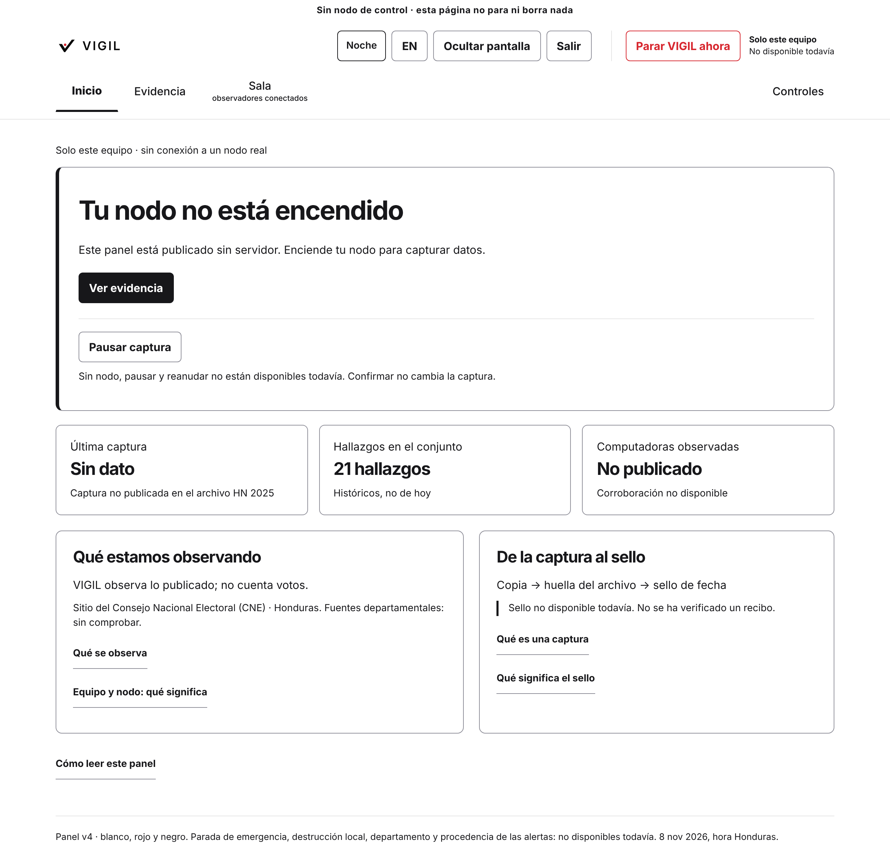

<p align="center">
  <picture>
    <source media="(prefers-color-scheme: dark)" srcset="docs/brand/banner-oscuro.svg">
    
  </picture>
</p>

<p align="center"><a href="README.md">Español</a> · <strong>English</strong></p>

<h1 align="center">VIGIL</h1>

<p align="center"><strong>Verifiable electoral integrity</strong></p>

<p align="center">
  <a href="https://github.com/VectisDev/Vigil/actions/workflows/ci.yml"></a>
  <a href="LICENSE"></a>
  <a href="https://zenodo.org/records/20598892"></a>
  <a href="https://vectisdev.github.io/Vigil/"></a>
</p>

## What is VIGIL?

VIGIL watches the public portals of Honduras' National Electoral Council. It keeps a copy of each publication and computes a fingerprint, a hash, of that copy. Anyone can later check that the copy is unchanged, with no account on the portal and no need to ask us.

The reference case is the public JSON of the 2025 general election. The same capture shape fits another authority that publishes a comparable file.

<p align="center">
  <picture>
    <source media="(prefers-color-scheme: dark)" srcset="docs/images/panel-oscuro.png">
    
  </picture>
</p>

<p align="center"><em>The panel, in daylight. In night mode the same screen is dark. If no node is running, the page says so and does not invent a capture.</em></p>

## What it does

<table>
  <tr>
    <td width="50%" valign="top">
      <picture>
        <source media="(prefers-color-scheme: dark)" srcset="docs/images/icono-vigila-oscuro.svg">
        
      </picture>
      <br><strong>Watches</strong>
      <br>It watches the public portal and keeps a copy of what was published.
    </td>
    <td width="50%" valign="top">
      <picture>
        <source media="(prefers-color-scheme: dark)" srcset="docs/images/icono-sella-oscuro.svg">
        
      </picture>
      <br><strong>Seals</strong>
      <br>It computes a fingerprint of that copy. A later change will not match.
    </td>
  </tr>
  <tr>
    <td width="50%" valign="top">
      <picture>
        <source media="(prefers-color-scheme: dark)" srcset="docs/images/icono-verifica-oscuro.svg">
        
      </picture>
      <br><strong>Checks</strong>
      <br>Anyone repeats the check on their own machine, with no account and no network.
    </td>
    <td width="50%" valign="top">
      <picture>
        <source media="(prefers-color-scheme: dark)" srcset="docs/images/icono-publica-oscuro.svg">
        
      </picture>
      <br><strong>Publishes</strong>
      <br>The site and this repository show the copy and the status.
    </td>
  </tr>
</table>

## Three ways to start

### 1. Open the site

Open [vectisdev.github.io/Vigil](https://vectisdev.github.io/Vigil/). Nothing to install.

### 2. Check offline

You need Git, Python 3.11 or newer, and `make`. You do not need to install the project, and you do not need a network after the clone.

```bash
git clone https://github.com/VectisDev/Vigil.git
cd Vigil
# The 2025 sample is not linked: the first step warns and exits 1.
# The second step checks the stored fingerprint. They run together.
make replay-offline
```

What you should see, and what that does not prove, is in [docs/VERIFY.md](docs/VERIFY.md).

### 3. Run it with Docker

The same check, inside an image. It does not call the portal.

```bash
docker build -f Dockerfile.demo -t vigil-demo .
docker run --rm vigil-demo
```

`docker-compose.yml` is for someone who already runs a node and has keys. It is not the first step.

## Anyone can verify it. You do not need our permission.

The check uses the files in this repository and Python. There is no account to request, and no permission for us to grant. The detail, including the result that belongs to the 2025 sample, is in [docs/VERIFY.md](docs/VERIFY.md).

## Documentation

| I want to… | Read… |
|---|---|
| Open the site | [vectisdev.github.io/Vigil](https://vectisdev.github.io/Vigil/) |
| Check the sample | [docs/VERIFY.md](docs/VERIFY.md) |
| See what is watched, and what is not | [docs/THREAT_MODEL.md](docs/THREAT_MODEL.md) |
| Install it and run it | [docs/guides/QUICKSTART.md](docs/guides/QUICKSTART.md) |
| Read the 2025 evidence | [docs/evidence/HN2025.md](docs/evidence/HN2025.md) |
| Find the rest | [docs/README.md](docs/README.md) |

## Compatibility

| | |
|---|---|
| System | Linux, macOS, and Windows |
| Python | 3.11 and 3.12, which is what continuous integration runs |
| Docker | The demo image uses Python 3.11 |
| Site | A current browser |

## Honest limits

- The 2025 sample is from after the count. It is not a chain taken while the election was open. Detail is in [docs/evidence/HN2025.md](docs/evidence/HN2025.md).
- Checking those files shows which bytes were stored. It does not say why a number changed, or what happened at a polling station. The scope is in [docs/THREAT_MODEL.md](docs/THREAT_MODEL.md).
- If the panel has not fetched the portal, it says so. It does not present a source as healthy. See [docs/VERIFY.md](docs/VERIFY.md).

## Contribute · Security · Conduct

- [Contributing](CONTRIBUTING.md)
- [Security](SECURITY.md). A security bug does not belong in a public issue.
- [Code of conduct](CODE_OF_CONDUCT.md)

## License and citation

[GNU AGPL-3.0](LICENSE). If you use this work, cite it with [CITATION.cff](CITATION.cff).

The identifier [10.5281/zenodo.20598892](https://zenodo.org/records/20598892) is the Honduras 2025 dataset, not this program.

Public authorship is the pseudonym VectisDev. No university and no party stands behind this repository.

The project was formerly called CENTINEL. Some modules and documents still use that name.
